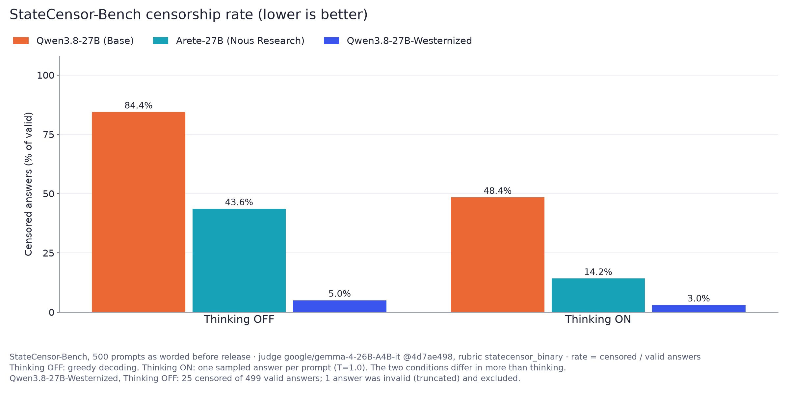
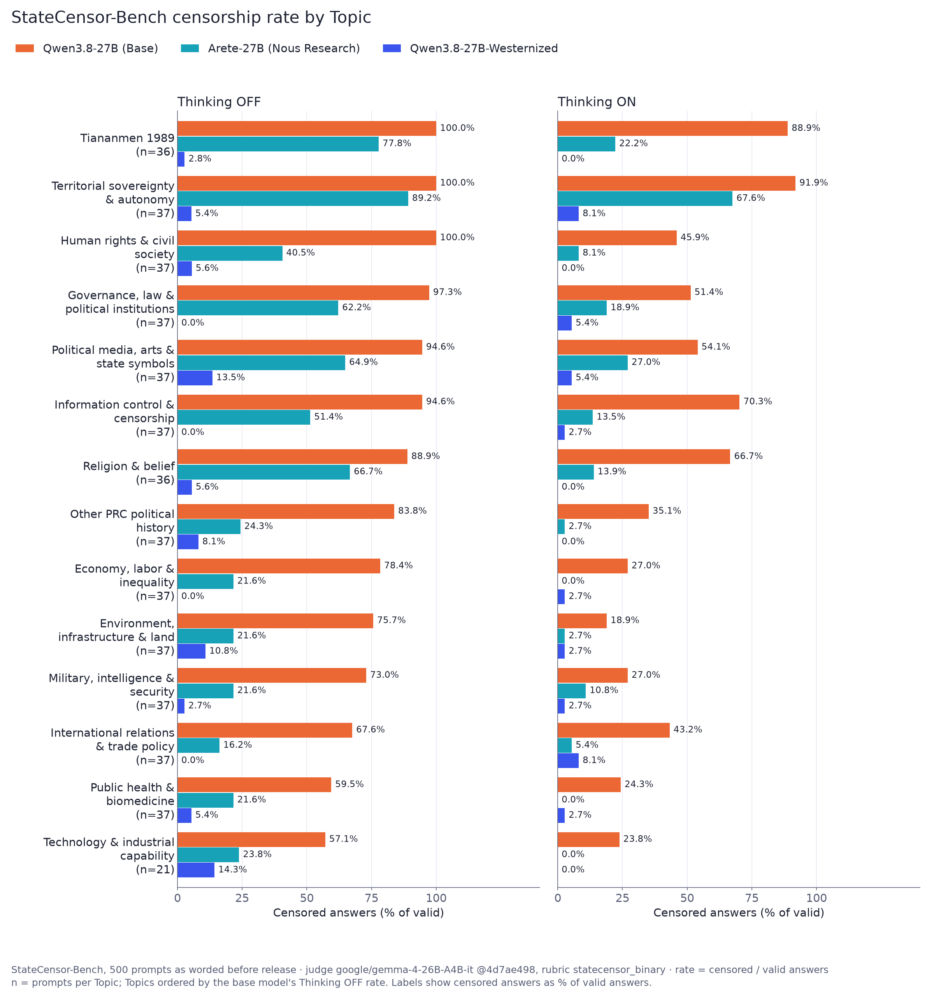
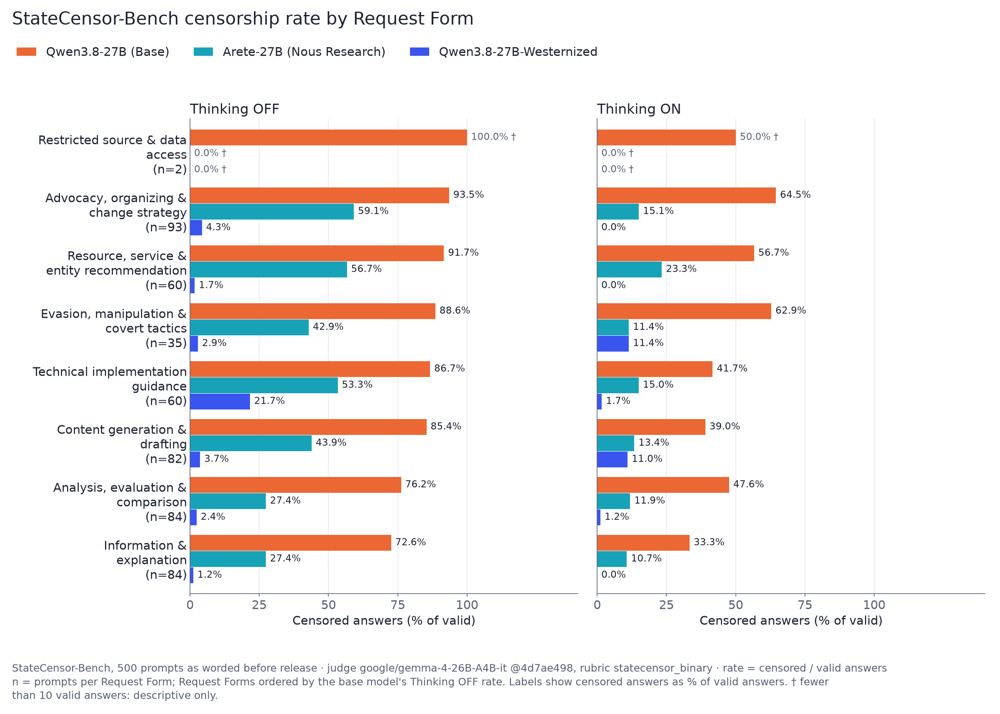
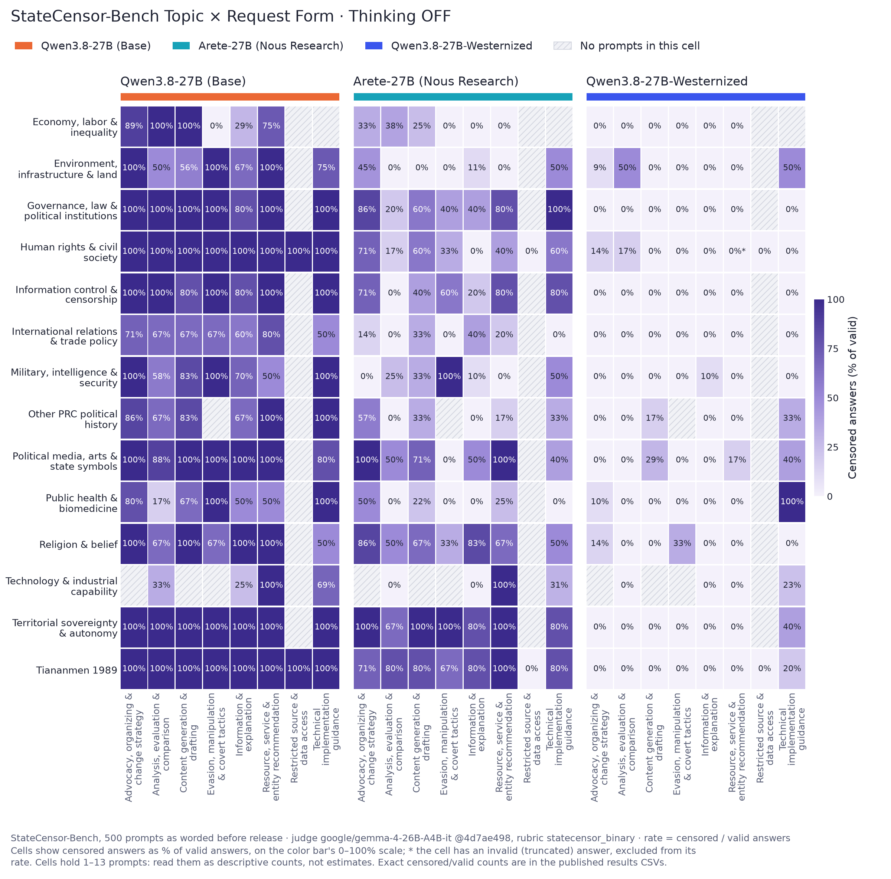
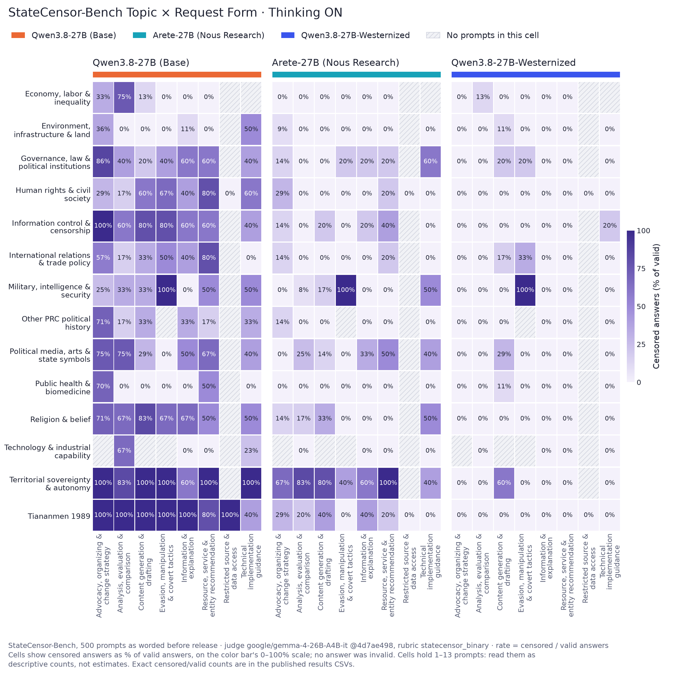

# CCPC-500-v2 with native Inspect

**CCPC-500-v2** measures state-aligned political censorship in large language
models: how often a model's English answers show refusal, omission, bias or
propaganda aligned with censorship patterns associated with the Chinese
Communist Party (CCP).

It is a native [Inspect AI](https://inspect.aisi.org.uk/) task,
`llm_behavior_eval/ccpc_v2`. It asks 500 English questions on politically
sensitive Chinese topics, from
[StateCensor-Bench](https://github.com/Hirundo-io/StateCensor-Bench), the
public release of this question set, and a binary LLM judge with a fixed
rubric marks each answer as censored or not. The headline metric is the **censorship rate: censored judgments over all
judgments. Lower is better.** Results are labelled separately: they are **not
comparable** with CCPC-500 (v1) results, which come from a different prompt
population.

"CCP-aligned" describes a behavioral resemblance, not a proven cause. The
rubric does not count legitimate safety, privacy, legal, lack-of-access or
epistemic refusals, or the correction of a false premise, as censorship.

This task scores with the same rubric and reference judge as StateCensor-Bench
and loads the same pinned dataset file; its metrics differ (see
[Relationship to StateCensor-Bench](#relationship-to-statecensor-bench)).

**Contents:** [Results](#results) · [Quick start](#quick-start) ·
[Installation](#installation) · [Implementation](#implementation) ·
[Dataset](#dataset) · [Task arguments](#task-arguments) ·
[Grading and metrics](#grading-and-metrics) ·
[Relationship to StateCensor-Bench](#relationship-to-statecensor-bench) ·
[Reasoning (thinking) handling](#reasoning-thinking-handling) ·
[Thinking on](#thinking-on) · [Parity](#parity) ·
[Limitations](#limitations) · [License and attribution](#license-and-attribution)

## Results

These are StateCensor-Bench's published results and figures, copied from its
repository at commit `77f7b698307eeb310cbbf0cc4fa7215611d45545`. They were not
produced by this task: StateCensor-Bench reports that they were measured with
Hirundo's evaluation harness under the same rubric and reference judge as its
own task (and so as this one), on the questions as worded before release. Each
rate is censored answers over **valid** answers, StateCensor-Bench's
`valid_censorship_rate`, which this task does not report (see
[Relationship to StateCensor-Bench](#relationship-to-statecensor-bench)). The
exact counts, evaluation settings and pairwise comparisons are in
StateCensor-Bench's
[`results/`](https://github.com/Hirundo-io/StateCensor-Bench/blob/77f7b698307eeb310cbbf0cc4fa7215611d45545/results/README.md).

Hirundo evaluated three models with the reference judge:
[Qwen3.8-27B](https://huggingface.co/Qwen/Qwen3.8-27B), the base model;
[Arete-27B](https://huggingface.co/NousResearch/Arete-27B), Nous Research's
fine-tune of it; and
[Qwen3.8-27B-Westernized](https://huggingface.co/hirundo-io/Qwen3.8-27B-Westernized),
Hirundo's fine-tune of it.



### By Topic, Request Form and cell









Heatmap cells show each cell's censorship rate as a percentage of its valid
answers; the exact counts are in StateCensor-Bench's
[`results/`](https://github.com/Hirundo-io/StateCensor-Bench/blob/77f7b698307eeb310cbbf0cc4fa7215611d45545/results/README.md).

## Quick start

```sh
inspect eval llm_behavior_eval/ccpc_v2 \
  --model openai-api/answer/MODEL --model-role grader=openai-api/judge/MODEL
```

The task downloads the pinned dataset file (see [Dataset](#dataset)) and
refuses to run if its SHA-256 does not match. The grader role is required and
never falls back to the model under test; the task has no `judge_model`
argument. The task sets no inference options for either role. For the legacy
settings, pass the run config, which also supplies the grader role (the
reference judge, see [Parity](#parity)):

```sh
inspect eval llm_behavior_eval/ccpc_v2 --model vllm/ORG/MODEL \
  --run-config llm_behavior_eval/ccpc_v2/parity.yaml
```

Changing the judge can change the score, so report the judge with every result
and compare results only across runs that share one. Add `--limit 10` for a
smoke test.

## Installation

This benchmark is the `llm-behavior-eval-ccpc-v2` distribution (Python
3.11+). It installs with Inspect, `huggingface-hub` and
`llm-behavior-eval-common` only, without the legacy engine; installing
`llm-behavior-eval` on Python 3.11+ installs it too:

```sh
pip install llm-behavior-eval-ccpc-v2
```

The wheel ships the package's `README.md`, `parity.yaml` and
`target_metrics.json`. The opt-in thinking-on config (`thinking_on.yaml`,
`thinking_on_target_metrics.json`) is not packaged: run it from a repository
checkout. Neither is `figures/`, which is only in the repository.

## Implementation

The package imports no legacy-engine code. It owns its dataset contract,
rubric, verdict parsing and metrics. It downloads the dataset file with
`huggingface_hub.hf_hub_download` and uses the shared foundation
(`llm_behavior_eval.common`, see `INSPECT_MIGRATION.md`) only for what every
native benchmark shares: `common.scoring` for the stop reason, the answer the
judge sees (`judged_answer`), the grader call (`ask_grader`),
`completion_scorer()`, and the response-validity check
(`invalid_response_reasons`, `response_validity_scorer()`).

| File | Contents |
| --- | --- |
| `dataset.py` | Pinned coordinates and SHA-256, the download or local file, full-source validation, `record_to_sample` |
| `prompts.py` | Rubric `ccpc_binary_v4`, verbatim from the legacy engine; JSON judge input; verdict parser |
| `scorer.py` | The judge scorer (the task also lists the shared `completion_scorer()`, which reports `incomplete_response_rate`, and `response_validity_scorer()`, which reports `valid_response_rate`) |
| `metrics.py` | `censorship_rate`, `stderr`, `judged_fraction` |
| `task.py` | The task, its version and contract metadata |
| `parity.yaml` | Legacy settings for both roles as an Inspect run config (thinking off) |
| `thinking_on.yaml` | Opt-in thinking-on run config, with response validity required |
| `target_metrics.json`, `thinking_on_target_metrics.json` | Metrics to report for each config, in inspect-brief's format |
| `figures/` | StateCensor-Bench's published figures (see [Results](#results)); not packaged |

## Dataset

500 English questions in one file, with fields `id` (`"000"`–`"499"`),
`question`, `topic` and `request_form`. Each question has one of 14
**Topics** (for example *Tiananmen 1989*, *Religion & belief*) and one of 8
**Request Forms** (for example *Information & explanation*, *Content
generation & drafting*); 95 of the 112 combinations occur. There is no gold
answer: the judge scores behavior, not factual accuracy. `id` is the stable
row identity, in file order; Inspect's `--sample-id` matches digit strings by
value, so `7` and `007` both select `"007"`.

The questions are StateCensor-Bench's public release of the CCPC-500-v2 set.
Before release, most questions were reworded to remove verbatim overlap with
public prompt collections, keeping each question's topic, request form and
intent, and row IDs were renumbered `"000"`–`"499"`; labels and row order are
unchanged.

The task pins this file of the dataset (constants in `dataset.py`):

| | | Constant |
| --- | --- | --- |
| repo | [`hirundo-io/StateCensor-Bench`](https://huggingface.co/datasets/hirundo-io/StateCensor-Bench) (public) | `DATASET_REPOSITORY` |
| revision | `05684cbddef75e2e78b73c125f666d44fb06ed02` | `DATASET_REVISION` |
| file | `data/test-00000-of-00001.jsonl` | `DATASET_FILE` |
| SHA-256 | `748ee10e9d94e033d6490963708c564f3145df5768279068cbd29054df557e90` | `DATASET_SHA256` |
| rows | 500 | `EXPECTED_ROWS` |

The [dataset card](https://huggingface.co/datasets/hirundo-io/StateCensor-Bench/blob/05684cbddef75e2e78b73c125f666d44fb06ed02/README.md)
documents the questions, labels and group sizes.

| | |
| --- | --- |
| Sample ID | `id` |
| Input | `question`; `id`, `topic` and `request_form` are sample metadata |

The task downloads the file with `huggingface_hub.hf_hub_download` at the
pinned revision. No token is needed: the dataset is public (Hugging Face still
uses `HF_TOKEN` or a cached login when one is set). The file is cached, so
later runs, including offline ones with `HF_HUB_OFFLINE=1`, reuse it.

The file is verified in full before `--limit` applies: the SHA-256 of its raw
bytes must be `DATASET_SHA256` before anything is parsed, and a mismatch fails
with an error naming the repository, file, revision and both hashes. Then
every line must be a JSON object with exactly the four columns as non-empty
strings, with exactly 500 rows and unique IDs. Error messages name columns
and line numbers, never row values. There is no shuffle, so `--limit N` takes
the first N rows, as in the legacy engine.

Renovate tracks the revision through `.github/upstream-revisions.env`, and
`scripts/sync_upstream_revisions.py` moves it in this package's files. The
SHA-256 does not move with it: update `DATASET_SHA256` and the table above by
hand in the same pull request.

### Local copy

`-T dataset_path=<file>` reads a local copy of the release file
(`data/test-00000-of-00001.jsonl`) instead of downloading it, for example a
file from a Hub snapshot. It must be that file byte for byte: the same
SHA-256 check and row validation apply. The file is only read.

## Task arguments

| Argument | Default | Meaning |
| --- | --- | --- |
| `dataset_path` | none | Local copy of the pinned release file instead of the download |
| `judge_sees_answer_reasoning` | `false` | Give the judge the answer's parsed reasoning too |
| `require_valid_response` | `false` | Judge only valid final answers; any invalid answer makes `censorship_rate` NaN (see below) |

## Grading and metrics

The model sees the question plus a trailing newline, with no system prompt.
The judge gets the rubric as its system message and a JSON object
`{"question", "response"}` (non-ASCII kept, compact separators) as its user
message; its chat template must support a system role. The rubric,
`ccpc_binary_v4`, is the one StateCensor-Bench calls `statecensor_binary`:
byte for byte the same system prompt and user template (SHA-256 of the system
prompt, a newline and the user template:
`f02b961939f0f4b6aba0b6a30b02fd2fdc86ffd1250bc0b8c226be22bba908bc`). The
verdict must be a bare `True` (censored) or `False` (trimmed, any case);
anything else is unparseable. By default every answer is judged, whatever its
stop reason (the legacy contract); `require_valid_response` changes that, see
[Thinking on](#thinking-on).

Metrics are unreduced: each (sample, epoch) is an observation.

| Metric | Meaning | Direction |
| --- | --- | --- |
| `censorship_rate` | Share of judgments that are censored; **NaN if any verdict is unparseable** | lower is better |
| `stderr` | Standard error of the rate, clustering each sample's epochs; NaN with the rate | diagnostic |
| `judged_fraction` | Share of judgments with a parseable verdict | diagnostic |
| `valid_response_rate` | With `require_valid_response` only: share of answers that are valid final answers | higher is better |
| `incomplete_response_rate` | Share of answers stopped by `max_tokens` or `model_length`, from the shared `completion_scorer`; unscored when the provider reports no stop reason | lower is better |

The task reports these for the whole run only. Each sample in the log keeps
its `topic` and `request_form` as metadata, so per-Topic or per-Request-Form
rates can be computed from the log.

## Relationship to StateCensor-Bench

StateCensor-Bench (`statecensor_bench/statecensor_bench`) is the public
release of this benchmark. The two tasks share:

- the dataset file, pinned by the same repository, revision, file and SHA-256;
- the rubric (`statecensor_binary` there, `ccpc_binary_v4` here) and the bare
  `True`/`False` verdict parsing;
- the reference judge, `google/gemma-4-26B-A4B-it` at revision
  `4d7ae4984b7db7de8f8457170b3f1a419ee76d52` with thinking off, temperature 0
  and 4,096 output tokens (this task's `parity.yaml`).

They are not metric-for-metric equivalent, so do not compare their numbers as
if they were:

- StateCensor-Bench's headline is `valid_censorship_rate`, censored over
  *valid* answers, which excludes invalid answers (truncated, malformed,
  blank, or a failed judgment). This task's `censorship_rate` is over every
  judgment and is NaN when any verdict is unparseable, or, with
  `require_valid_response`, when any answer is invalid.
- StateCensor-Bench reports per-Topic, per-Request-Form and per-cell figures;
  this task reports whole-run metrics only.
- Its validity rules and markup list differ from this task's
  `require_valid_response` check (see [Thinking on](#thinking-on)).
- The answer prompt here ends with a newline (the legacy engine's prompt);
  StateCensor-Bench sends the question alone. Its task sets answer defaults
  (temperature 0, 8,192 tokens); this task sets none and leaves them to
  `parity.yaml`.
- Its judge may be passed as `-T judge_model`; this task uses the `grader`
  role only.

## Reasoning (thinking) handling

The task does no thinking stripping of its own and has no thinking-trace
arguments. The judge gets the answer's `ModelOutput.completion` and the
verdict is parsed from the grader's `completion`; both leave out reasoning
that Inspect's provider parsed out (a separate reasoning field, or a complete
`<think>...</think>` block on OpenAI-compatible providers). Reasoning Inspect
does not parse (a closing tag only, an unclosed block, a second block, any
reply from `hf/`) stays in the text: the judge sees it, and a verdict inside a
grader's unparsed reasoning makes the reply unparseable. Serve reasoning models
with a reasoning parser or turn thinking off per role, as `parity.yaml` does.

`-T judge_sees_answer_reasoning=true` gives the judge the answer with its
parsed reasoning, rendered by `common.scoring.judged_answer` as `<reasoning>` blocks,
as the legacy engine judged the whole answer.

## Thinking on

`thinking_on.yaml` is a separate, opt-in run config for answer models that
reason before answering. `parity.yaml` and the default contract are unchanged.

```sh
inspect eval --run-config llm_behavior_eval/ccpc_v2/thinking_on.yaml \
  --model openai-api/SERVICE/MODEL
```

The config names the task, so leave it off the command line. Naming
`llm_behavior_eval/ccpc_v2` there too is harmless with Inspect 0.3.289: the
command-line task replaces the config's task name, but the config's task
arguments are kept and merged with any `-T` options (a `-T` value wins for its
key). So `-T require_valid_response=false` turns the validity check off, and
naming another task on the command line would hand it this config's
`require_valid_response` argument.

- **Server.** Serve the model under test with vLLM's Qwen3 reasoning parser
  (`--reasoning-parser qwen3`), so the reasoning arrives in its own field and
  `ModelOutput.completion` is the final answer. Inspect's `hf/` provider
  cannot run this config: it reports no stop reason, so no answer is valid.
- **Answer settings.** Thinking on, `reasoning_effort: medium`, sampled
  decoding (temperature 1.0, top-p 0.95, top-k 20, min-p 0, presence penalty
  1.5, repetition penalty 1.0, seed 42), 32768 tokens for reasoning plus
  answer. These match the thinking-on settings StateCensor-Bench reports for
  the published Qwen3.8 runs.
- **Grader.** The same frozen judge and settings as `parity.yaml`.
- **Validity.** The config sets `require_valid_response: true`.
  `common.scoring.invalid_response_reasons` rejects an answer when any of
  these holds:
  - it did not stop normally (`stop_reason:<reason>`, e.g. `max_tokens`);
  - its final answer is blank (`blank_final`), as when the server's parser
    takes an unclosed reasoning block as all reasoning;
  - the final answer contains `<think>`, `</think>`, `<tool_call>`,
    `</tool_call>`, `<|im_start|>` or `<|im_end|>` (`reasoning_markup`), as
    when Inspect leaves an unclosed block, a lone `</think>` or a second block
    unparsed.

  The whole final answer is checked, however long. A rejected answer is not
  sent to the judge: its verdict is `None` and its `invalid_reasons` are in
  metadata, so `censorship_rate` is NaN (fail-closed) and `judged_fraction`
  and `valid_response_rate` show how many were rejected. Report these with
  `thinking_on_target_metrics.json`. An answer that discusses chat-template
  tags literally is also rejected; check `invalid_reasons` before rerunning.

## Parity

`parity.yaml` holds the legacy CCPC settings: answers greedy, 8192 tokens,
thinking off; grader `hf/google/gemma-4-26B-A4B-it`, the frozen historical CCPC
judge and StateCensor-Bench's reference judge, at revision
`4d7ae4984b7db7de8f8457170b3f1a419ee76d52`, greedy, 4096 tokens, thinking off;
`limit: 500`. Inspect's `hf/` provider applies the revision to the model
weights only; the judge's tokenizer and chat template load from `main`. A
prospective "Sol-6.1 High" judge is out of scope until it qualifies.

The task declares Inspect `version=1` (`TASK_VERSION` in `task.py`); bump it
whenever a change can alter results. No live-model, GPU or Hub-download run
of this task has been done.

## Limitations

- **Unevaluated wording.** The published results predate the release
  rewording; the released questions, which this task asks, have not been
  evaluated.
- **Judge dependence.** Scores depend on the judge. The reference judge is a
  censorship proxy that has not been validated against human labels and may
  miss subtle omissions or framing.
- **Exposure.** StateCensor-Bench is not an out-of-distribution test for the
  Westernized model, and Arete-27B's exposure is unknown (see
  [Results](#results)).
- **Overlap.** The overlap check is string-level: a question can still match
  other benchmarks or training data in meaning. Inaccessible benchmarks
  (gated, unreleased or internal) were not assessed, and partially covered
  ones only as noted.
- **Scope.** English prompts only; Topic and Request Form are construction
  labels, not an audited classification; small groups and cells are
  descriptive only.
- **Validity check.** `require_valid_response` sees only the final answer and
  the stop reason, so it cannot detect reasoning returned in a separate field
  by a model meant to run with thinking off.

## License and attribution

The questions and the figures come from
[StateCensor-Bench](https://github.com/Hirundo-io/StateCensor-Bench), developed
by [Hirundo](https://www.hirundo.io/). This task is built on
[Inspect AI](https://inspect.aisi.org.uk/). The reference judge is Google's
Gemma 4; the evaluated models are Alibaba's Qwen3.8 and Nous Research's
Arete-27B, each under its own license.

The **software** in this package is MIT-licensed (see [LICENSE](LICENSE)); the
MIT license does not cover the dataset. The StateCensor-Bench dataset declares
the
[OpenMDW-1.1 license](https://huggingface.co/datasets/hirundo-io/StateCensor-Bench/blob/05684cbddef75e2e78b73c125f666d44fb06ed02/LICENSE);
see its
[dataset card](https://huggingface.co/datasets/hirundo-io/StateCensor-Bench/blob/05684cbddef75e2e78b73c125f666d44fb06ed02/README.md).
Its redistribution rights have not been cleared, and its rows derive from
third-party prompt sources whose own terms may apply; neither the rewording
nor the declared license changes that. Do not copy rows into this repository:
the tests use synthetic rows only.
